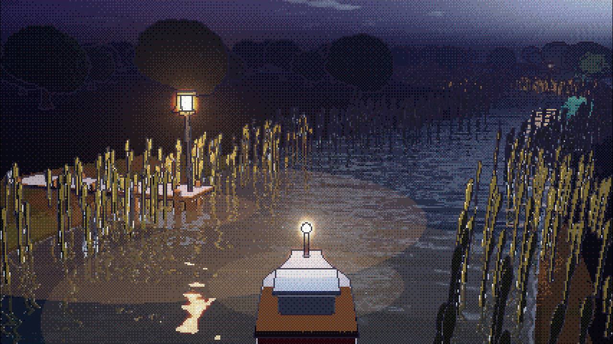

# Riacho

Una lancha de noche por el Delta del Paraná. Prendé seis faroles hasta la torre del Nodo sin que la luz mala te deje sin linterna. Dura unos dos minutos.

**Jugar:** https://kvothesson.com/riacho/ · WASD o flechas, M para el sonido.

## Cómo está hecho

Todo con código, en un solo `index.html`, sin modelos, texturas ni sonidos grabados.

- **Escena:** raymarching de campos de distancia (WebGL2) a resolución baja, con reflejos en el agua y niebla.
- **Look:** sombreado por bandas, línea de tinta por discontinuidad de profundidad y normal, color cuantizado en Oklab con tramado Bayer y escalado entero.
- **Rendimiento:** el canal y el terreno se hornean una vez en una textura; las cotas del marcher nunca cuentan como superficie. Unos 9 ms por cuadro en 1080p en una GTX 960.
- **Sonido:** WebAudio sintetizado (agua, motor, el silbido de la luz mala, campanas y el acorde final).

## Herramientas

- `abrir.cmd`: sirve la carpeta en el puerto 5331 y abre el juego.
- `shots.sh`: saca los cuadros clave con Chrome headless (`?shot=1|2|3|intro|perdida|final`).
- `medir.py`: ms por cuadro con reloj real.
- `jugar.py`: un piloto automático juega la partida entera y reporta cada evento (`python jugar.py lento` simula a alguien vacilante).

Hecho por [Kvothesson](https://kvothesson.com/).
